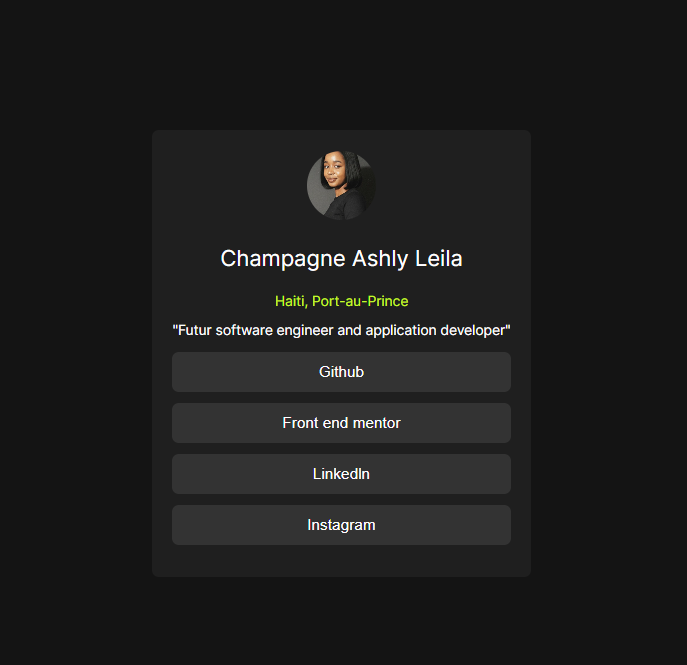

# Frontend Mentor - Social links profile solution

This is a solution to the [Social links profile challenge on Frontend Mentor](https://www.frontendmentor.io/challenges/social-links-profile-UG32l9m6dQ). Frontend Mentor challenges help you improve your coding skills by building realistic projects. 

## Table of contents
  - [Screenshot]()
  - [Links](#links)
  - [My process](#my-process)
  - [Built with](#built-with)
  - [What I learned](#what-i-learned)
  - [Continued development](#continued-development)
  - [Author](#author)

### Screenshot

### Links

- Solution URL: [https://github.com/AshlyLeila/Social-link]
- Live Site URL: [https://ashlyleila.github.io/Social-link/]

## My process

### Built with

- Semantic HTML5 markup
- CSS custom properties
- Flexbox
- CSS Grid

### What I learned

For this project, I mainly applied what I already knew about HTML and CSS, without needing any new concepts.

Since I didn't have access to the Figma file, I had no guide for exact spacing, font sizes, or colors. I had to rely on the design preview image and adjust everything by eye, comparing my result with the preview until it looked right.

This helped me become more independent and more confident in my ability to build a layout on my own.

### Continued development

In my next projects, I want to structure my work better and focus on two areas:

- Git: writing clearer commits and keeping my repositories organized.
- CSS Grid: I still find it a bit difficult, so I plan to practice it by building more layouts.

I understand that these skills improve with practice, so I intend to build more projects to keep progressing.

## Author

- Website - [https://portfolio-blush-gamma-73.vercel.app/#home]
- Frontend Mentor - [@AshlyLeila](https://www.frontendmentor.io/profile/AshlyLeila)

# Social-link
